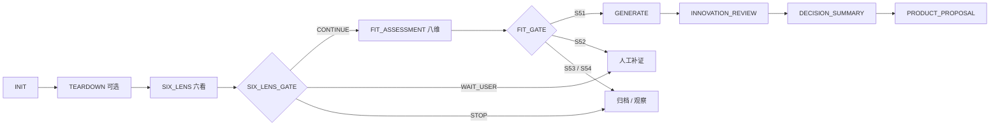
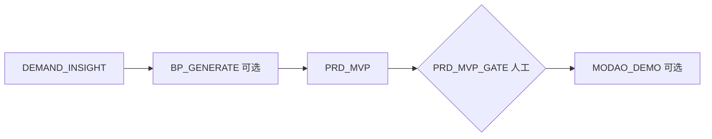
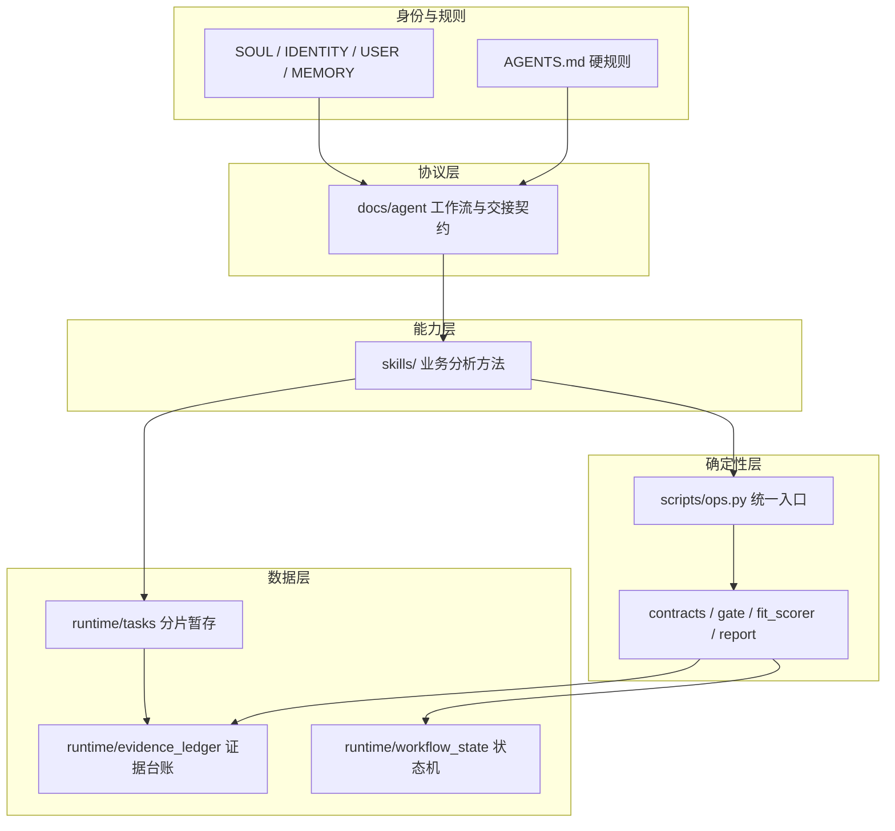

# AI Product Manager Employee

> 让 AI 做调研，让脚本做决定，让产品经理只做判断。

一个基于 OpenClaw 的、可审计的 AI 产品经理工作流。它不是一套提示词，而是把“产品机会评估”做成状态机的数字员工工作区：模型负责搜集、整理和起草；Python 脚本负责评分、门禁、状态迁移和报告；人只在应该停下的地方做决定。

本仓库是脱敏框架版。所有示例均为合成数据，不包含任何公司、客户或个人业务信息。

## ✨ 亮点速览

- **可审计的 AI 决策**——每个结论都能回溯到带等级、来源、日期的证据条目，评审时不再“依据呢？”
- **LLM 提议，脚本裁决**——评分、门禁、状态迁移全部由确定性 Python 脚本执行，杜绝模型“拍脑袋打分”
- **证据台账 + 双源校验**——A/B/C 分级、双独立来源、时效窗口（政策 366 天 / 其余 183 天），缺证保守放行
- **长任务断点续跑**——六看拆成 6 个分片并行落盘，子 Agent 挂掉最多损失一维，不从头再来
- **人在环上，该停就停**——Gate 只有 `CONTINUE / WAIT_USER / STOP / ERROR` 四种动作，只在该找人的时候找人
- **49 个回归测试**——评分、门禁、分片、端到端分支全部有测试兜底

**一句话总结：把产品经理从“搜资料、拼证据、算分、写报告”的机械循环里解放出来，只保留最有价值的部分——判断。**

---

## 为什么做这个

产品经理评估一个新机会，通常要经历同样的循环：

1. 翻市场、资本、行业、政策、用户、竞品六类资料；
2. 把散落在网页、截图、聊天记录里的证据拼起来；
3. 拍一个“靠不靠谱”的判断；
4. 写一份汇报，过两周被问“依据呢”，再从头翻一遍。

问题不在于 AI 不会搜，而在于：

- 搜完的东西留不下来，下一个同类机会还要重搜；
- 结论和证据脱节，模型说“高适配”，但没人知道分怎么来的；
- 流程靠人记，跳步、漏证、重复确认；
- 长任务一断，上下文一丢，整段工作归零。

这个项目把上面四件事分别交给四层机制：**证据台账、确定性脚本、状态机、分片落盘**。

---

## 它是什么，不是什么

**是：**

- 一套可运行的产品机会评估工作流，带命令行入口和测试；
- 一套“LLM 提议、脚本裁决”的协作协议；
- 一个可复用的 OpenClaw 工作区模板：人格、规则、Skill、脚本、运行数据分层。

**不是：**

- 不是“一键生成 PRD”的黑盒；
- 不是替代产品经理判断的自动决策器；
- 不是通用 Agent 框架，也不绑定某一家模型；
- 当前不承诺自动生成 DOCX / XLSX / PPTX。

---

## 核心特色

### 1. 不确定交给 LLM，确定交给脚本

模型可以写分析、给结论、打 0-10 的原始分，但：

- 加权总分只能由 `scripts/fit_scorer.py` 计算；
- S51/S52/S53/S54 只能由 `scripts/gate_check.py` 判定；
- 状态迁移只能走 `scripts/contracts.py` 的白名单；
- 正式报告只能由 `scripts/generate_report.py` 生成。

模型说“我觉得 85 分”不算数；脚本算出来才算。

### 2. 每个结论都能回到证据

证据必须带 `fact / source / date / grade / signal` 五个字段。要支撑 YES 或 S51，还必须满足：

- A 级或 B 级；
- 正向信号；
- 维度匹配；
- 在时效内（政策 366 天，其余 183 天）；
- 至少两个不同来源标识。

C 级证据只能当线索，不能单独放行。字符串不同不等于来源独立，最终独立性仍需人工核验——脚本只负责“够不够门槛”。

### 3. 长任务不怕断

六看默认拆成 6 个分片，按 3 个 worker × 2 维并行。每完成一维立即落盘到 `runtime/tasks/`，主 Agent 再用 `task merge` 在脚本内合并。

- 子 Agent 上下文丢了，最多损失当前一维；
- 重新 `task init` 不会重置已完成分片；
- 大块证据不经过模型上下文，减少污染和 token 消耗。

### 4. 该停就停，不自动往下冲

Gate 只有四种动作：`CONTINUE`、`WAIT_USER`、`STOP`、`ERROR`。

- `WAIT_USER`：必须把结论、证据数、待补事项发给用户，然后停；
- `STOP`：正常业务结论，归档结束；
- `ERROR`：区分瞬时失败和结构性失败，结构性失败禁止原样重试。

同一 `ledger_version` 的 Gate 已经是 `WAIT_USER` 或 `STOP` 时，再次调用直接返回原结果，不会重复写状态。

### 5. 恢复只补发，不重放

Gate 结果需要送到会话或 IM。为防止重复通知，`pending_output` 用三态：

```text
pending → sending → sent
```

- 同一 `delivery_key` 已有未完成记录，不新建；
- 有回执就不再发；
- 已 `sent` 只跳过。

恢复会话时只补发未送达的结果，不重跑六看、不重写台账、不重跑 Gate。

### 6. 主 Agent 是唯一写入者

```text
主 Agent：登记分片 → 派生子 Agent → 校验 → 合并 → 写台账 → 跑 Gate
子 Agent：接收有界任务 → 分析 → 只写 runtime/tasks/ 分片
```

子 Agent 不跑 Gate、不改状态、不生成正式产物。这样并行分析不会写坏同一份状态，最终决策也始终可审计。

---

## 两条工作流

### 工作流 A：产品机会评估（默认）



六看维度：`market / capital / industry / policy / user / competitor`。其中 `market / user / competitor` 是核心维度，任一缺失或为 WATCH/NO，六看不得以 YES 放行。

八维适配度（满分 100，权重固定）：

| 维度 | 权重 |
| --- | ---: |
| 市场 / 趋势确定性 | 10 |
| 用户需求强度 | 15 |
| 品类 / 竞品验证 | 10 |
| AI 价值必要性 | 10 |
| 组织能力匹配 | 25 |
| 快速落地可行性 | 15 |
| 商业转化路径 | 10 |
| 成本与风险可控性 | 5 |

分档：

| 总分 | 等级 | 动作 |
| ---: | --- | --- |
| ≥ 80 | S51 高适配 | 进入创新评审 |
| 65–79 | S52 中适配 | 补证后复评 |
| 50–64 | S53 低适配 | 观察池 |
| < 50 | S54 不适配 | 暂停 |

### 工作流 B：需求驱动产品提案



B 的入口依赖工作流 A 的 `FIT_GATE`。这是刻意的“先评估、再执行”，适合部门级立项流程，不适合“用户随口提需求，立刻出 PRD”的轻场景。

---

## 功能清单

| 能力 | 实现 |
| --- | --- |
| 机会输入分流 | `skills/innovation-opportunity-control` |
| 单品拆解 | `skills/product-intelligence-teardown` |
| 前沿机会扫描 | `skills/frontier-opportunity-discovery`（漏斗后停止，不写台账） |
| 六看压力测试 | `skills/six-lens-opportunity-scan` + 分片任务 |
| 八维适配度 | `skills/fit-assessment` + `scripts/fit_scorer.py` |
| 机会评估主链路 | `skills/ai-product-evaluation` |
| 需求洞察 / BP / PRD | `skills/demand-insight`、`bp-generator`、`prd-mvp` |
| 原型 Demo | `skills/modao-*`（可选，依赖墨刀 MCP） |
| 原生 PPT / Word 包装 | `skills/innovation-opportunity-packaging` |
| 统一命令行 | `python scripts/ops.py innovation:...` |
| 证据台账 | `runtime/evidence_ledger/` |
| 状态机 | `runtime/workflow_state/` |
| 分片暂存 | `runtime/tasks/` |
| 回归测试 | `tests/`，49 个用例 |

公共版包含 18 个 Skill。第三方 PPT 资源包（`ppt-master`）未随仓库分发，避免引入体积和授权不明的素材。

---

## 效率提升从哪里来

| 环节 | 传统做法 | 这套流程 |
| --- | --- | --- |
| 资料搜集 | 人工开多个页面、复制粘贴 | 3 个 worker × 2 维并行，完成即落盘 |
| 证据整理 | 散在聊天记录、文档、截图 | 台账统一字段，A/B/C 分级，双源校验 |
| 评分汇总 | Excel 手工加权，口径容易漂 | 固定权重，脚本计算，明细可复算 |
| 流程推进 | 靠人记下一步 | 状态机 + Gate，只有 `WAIT_USER` 才找人 |
| 长任务中断 | 从头再来 | 分片续跑，已完成分片不重置 |
| 汇报出稿 | 手工拼报告 | 统一 Markdown 产物与门禁 |
| 复盘审计 | 找不到依据 | 证据 ID、版本历史、Gate 结论绑定台账版本 |

这些是机制层面的提效，不是营销数字。具体幅度取决于机会数量、检索成本和补证频率。建议用 3 个真实机会做一次基线对比：记录每个机会的检索小时数、补证轮次、出稿时间和返工次数，再与手工流程对照。

---

## 架构



设计上刻意做了“渐进披露”：`AGENTS.md` 只放始终生效的红线；工作流细节放 `docs/agent/`；分析方法放 `skills/`；判定逻辑放 `scripts/`；运行数据放 `runtime/`，且永远不被当成指令。

---

## 快速开始

### 环境

- Python 3.10+
- 可选：OpenClaw（需要完整的子 Agent 调度、会话投递能力时）

只跑确定性脚本和测试，不需要 OpenClaw。

### 运行测试

```bash
python -m unittest discover -s tests -v
```

### 跑一个最小机会评估

```bash
python scripts/ops.py innovation:ledger init \
  --id demo --product "Demo 产品" --user "目标用户"

python scripts/ops.py innovation:task init \
  --id demo --stage SIX_LENS

# 为六个维度各准备一个分片 JSON，完成一维就写入一维
python scripts/ops.py innovation:task part \
  --id demo --stage SIX_LENS --part market --file market.json

python scripts/ops.py innovation:task status --id demo --stage SIX_LENS

# 六片齐备后合并；缺片会被拒绝，除非显式 --allow-partial
python scripts/ops.py innovation:task merge \
  --id demo --stage SIX_LENS

# 用 merge 产物写正式台账，再跑 Gate
python scripts/ops.py innovation:ledger write-six-lens \
  --id demo --conclusion CONDITIONAL \
  --evidence-file runtime/tasks/demo/SIX_LENS/merged-evidence.json \
  --dimensions-file runtime/tasks/demo/SIX_LENS/merged-dimensions.json \
  --tasks-file runtime/tasks/demo/SIX_LENS/merged-tasks.json

python scripts/ops.py innovation:gate check --id demo --stage SIX_LENS
```

`CONDITIONAL` 会返回 `WAIT_USER`，这是正常设计：Gate 停下来，等人决定补不补证。

分片 JSON 的最小形状：

```json
{
  "dimension": "market",
  "conclusion": "CONDITIONAL",
  "key_facts": ["事实"],
  "unknowns": ["未知项"],
  "evidence": [
    {
      "dimension": "market",
      "fact": "一条可核查的事实",
      "source": "来源 A",
      "corroborating_sources": ["来源 B"],
      "date": "2026-10-21",
      "grade": "A",
      "signal": "正向"
    }
  ]
}
```

---

## 目录结构

```text
.
├── AGENTS.md                  # 始终生效的工作区规则
├── SOUL.md / IDENTITY.md      # 人格与身份
├── USER.md / MEMORY.md        # 用户信息与长期记忆（模板）
├── docs/agent/                # 工作流、编排、操作、检索、安全、输出协议
├── docs/IMPLEMENTATION.md     # 确定性命令的实施范围与边界
├── skills/                    # 18 个业务 Skill
├── scripts/
│   ├── ops.py                 # 统一命令入口
│   ├── contracts.py           # 阶段、状态、迁移、证据校验（唯一契约）
│   ├── fit_scorer.py          # 八维加权评分
│   ├── gate_check.py          # 六看与适配度 Gate
│   ├── evidence_ledger.py     # 证据台账
│   ├── workflow_state.py      # 状态机
│   ├── generate_report.py     # 受控报告
│   └── ops_commands/          # 命令模块
├── schemas/                   # 台账与状态 JSON Schema
├── tests/                     # 49 个回归用例
└── runtime/
    └── templates/             # 工作流 B 的产物模板
```

运行后会自动生成 `runtime/evidence_ledger/`、`runtime/workflow_state/`、`runtime/tasks/`、`runtime/logs/` 和 `runtime/outputs/`，这些目录默认不提交。

---

## 设计原则

1. **不确定交给 LLM，确定交给脚本。**
2. **主 Agent 唯一写入，子 Agent 只写暂存。**
3. **分片落盘，断点续跑。**
4. **恢复只补发，不重放。**
5. **失败先分类，再决定重试还是降级。**
6. **证据先行，缺证保守，结论强度不超过证据强度。**
7. **Gate 该停就停，不替人做决定。**

---

## 能力边界

- 受控命令当前只稳定产出 **Markdown**；DOCX、XLSX、PPTX 属于 Skill 或人工能力。
- 前沿扫描完成漏斗和 A/B/C 分流后停止，不写台账、不跑 Gate。
- 工作流 B 代码完整，但缺少真实案例验证；请先在小范围试用。
- 全自动子 Agent 调度依赖 OpenClaw 的 `sessions_spawn` / `sessions_yield`；脱离 OpenClaw 时，确定性命令仍可单独使用。
- 脚本只能校验证据字段、日期、等级和来源字符串，不能证明来源真实独立；关键事实仍需人工核验。

---

## 适合谁

- 需要频繁评估新品、新品类、新机会的产品经理；
- 希望把 AI 产出纳入评审流程，而不是停留在聊天窗口的团队；
- 想复用“证据台账 + 确定性门禁”这套方法，改造自己流程的研发/创新团队。

如果你只需要一个会聊天的助手，这套东西会显得重；如果你需要的是“AI 干完活，结论能过评审”，它正好。

---

## 测试

```bash
python -m unittest discover -s tests -v
```

当前 49 个用例覆盖：

- 八维评分与边界校验；
- 六看 Gate 的核心维度守卫与证据缺口；
- 适配度 S51–S54 分档；
- 分片登记、逐片落盘、缺片拒绝、合并去重、断点续跑；
- 端到端 YES / CONDITIONAL / NO 分支；
- 报告门禁与状态同步。

测试夹具全部为合成数据，不代表任何真实产品结论。

---

## License

[MIT](LICENSE)

## 致谢

- OpenClaw：工作区、会话与子 Agent 调度底座；
- 墨刀 MCP：可选的原型 Demo 通道；
- 所有在真实项目里被这套流程拦下来过的错误结论。

---

## English Summary

**AI Product Manager Employee** is an OpenClaw-based, auditable workflow for product opportunity evaluation.

LLMs do research and drafting. Python scripts own scoring, gates, state transitions, and report generation. The project ships with:

- a six-lens opportunity scan with core-dimension guards;
- an 8-dimension weighted fit model (S51–S54);
- an evidence ledger with grading, double-sourcing, and freshness rules;
- sharded sub-agent execution with checkpoint/resume;
- an idempotent human-in-the-loop delivery mechanism;
- 49 regression tests.

The core idea is simple: **let the model propose, let the scripts decide, and let the product manager judge.**
